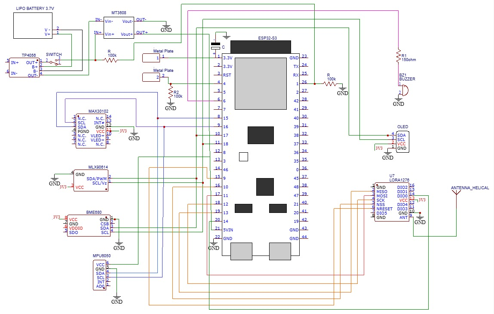
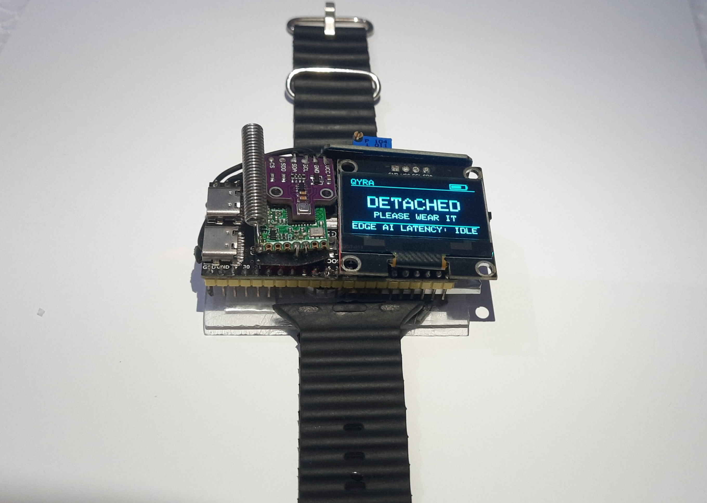
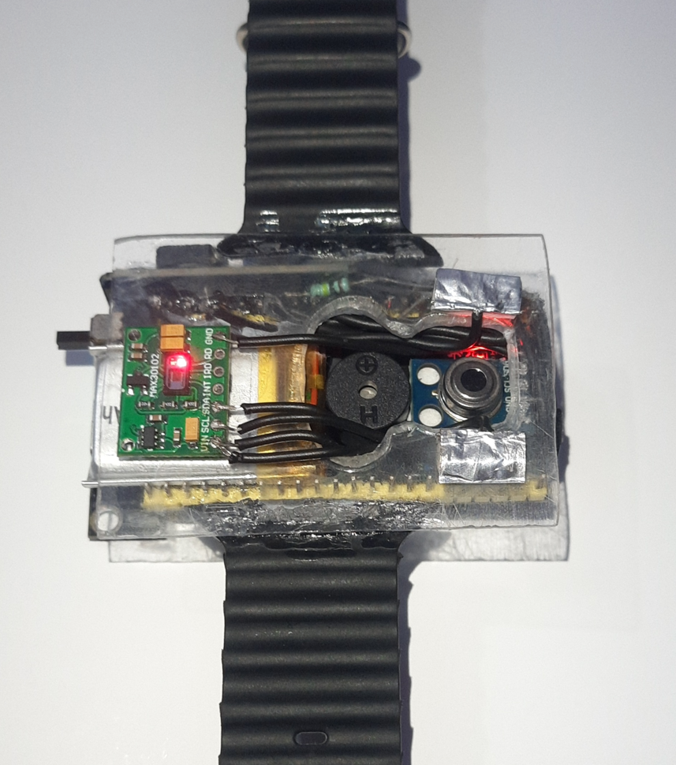

# QYRA: Wearable Edge-AI Health & Disaster Companion
> **Smart India Hackathon 2026 | Team Vision.exe (Team ID: 162907) | PS 26181**

---

## Overview: The QYRA Paradigm
Conventional health wearables suffer from a fatal flaw: they become expensive paperweights the moment cloud connectivity drops, and they rely on flat, sensor thresholds that trigger way more false alarms. 

**QYRA fundamentally re-engineers the medical assistive wearable for disaster zones, off-grid environments, and high-risk industrial sectors. It is a 100% offline, privacy-first Edge-AI triage ecosystem.**

Instead of blindly streaming raw data to a server, QYRA acts as a miniaturized autonomous clinic on the wrist. By fusing clinical biometrics with kinematics and environmental gas data, its onboard TinyML neural network locally classifies complex physiological states—such as Heat Strain (PSI) and Respiratory Risk (RDI)—in real-time. When critical infrastructure fails, QYRA bypasses cellular networks entirely, leveraging a sub-GHz LoRa mesh to broadcast encrypted emergency payloads.

### Core Engineering Pillars
* **Multi-Modal Edge AI:** Moves computation from the cloud to the silicon. An INT8-quantized TinyML model fuses 5 distinct sensor streams to eliminate heuristic false alarms.
* **Hardware-Accelerated RTOS:** Utilizes an asymmetric dual-core FreeRTOS architecture with physically isolated I2C buses, guaranteeing that heavy UI rendering never interrupts high-frequency 50Hz medical polling.
* **Zero-Infrastructure Mesh:** Deploys an SX1276 LoRa transceiver (IN865 MHz) to establish a decentralized, peer-to-peer SOS network independent of Wi-Fi, 4G, or 5G grids.
* **Cryptographic Privacy (DPDP Compliant):** No cloud backend. Demographic models are provisioned securely into Non-Volatile Storage (NVS). Protected Health Information (PHI) never leaves the device.

---

## Physical Prototype & Hardware Architecture
To prevent high-frequency OLED UI refreshes from choking the I2C clock and stalling the sensitive PPG sensor, the physical MVP hardware is split across two independent data buses on the ESP32-S3.

* **I2C Bus 0 (Clinical - 100kHz):** Vitals and Kinematics.
* **I2C Bus 1 (Environment & UI - 100kHz):** Ambient Gas/Temp/Humidity and 1.3" SH1106G OLED Display.

### Circuit Schematic & Assembled Hardware
| Circuit Schematic | Assembled Prototype (Front) | Assembled Prototype (Back) |
| :---: | :---: | :---: |
|  |  |  |

*(See the `hardware/` and `docs/` directories for detailed bus wiring topologies and architecture flowcharts.)*

---

## Architecture: MVP vs. Production Roadmap
To validate the architecture for the hackathon, we built a fully functional MVP using commercial off-the-shelf (COTS) components. However, our engineering architecture is designed to scale directly into a clinical-grade production pipeline utilizing advanced Qualcomm IoT SoCs and medical-grade optical front-ends.

> **1. [ SENSE ]**
> * **MVP (Current):** MAX30102 (SpO2/HR) | MPU6050 (IMU) | BME680 (Gas/Env) | MLX90614 (Temp) | Analog GSR
> * **Production Vision:** MAX86141 (Clinical PPG) | LSM6DSOX (Motion) | BME688 (VOC/Env) | TMP117 (Skin Temp) | SPI/I2C Isolation

> **2. [ COMPUTE & RTOS ]**
> * **MVP (Current):** ESP32-S3 executing FreeRTOS with asymmetric dual-core task isolation and CMSIS-DSP motion-aware filtering.
> * **Production Vision:** Qualcomm QCC748M Tri-Radio SoC for enhanced power efficiency and hardware-accelerated DSP.

> **3. [ AI INFERENCE ]**
> * **Edge Engine:** INT8-quantized TinyML models (<100KB) running locally. 
> * **Triage Logic:** Lightweight temporal sliding-window anomaly detection and baseline deviation scoring. NVS provisioning locks the models to specific demographic profiles.

> **4. [ ACTION & MESH ]**
> * **Alerting:** Local OLED + Buzzer (Immediate alert, no network needed).
> * **Off-Grid Telemetry:** SX1276 LoRa transceiver operating on the IN865 MHz band paired with ESP-NOW for decentralized rescue mesh broadcasting.
> * **App Ecosystem:** Flutter Dart companion app with AES-256 local SQLite storage.

---

## Privacy-by-Design (DPDP Aligned)
* Routine physiological analysis occurs locally on the wearable.
* Raw biometric numbers are masked by default via PHI (Protected Health Information) toggled by user.
* Telemetry logs are stored securely with zero cloud-backend dependency.

---
*Disclaimer: QYRA is a prototype intended for preventive health awareness and disaster emergency support. It is not a substitute for professional clinical diagnosis.*
