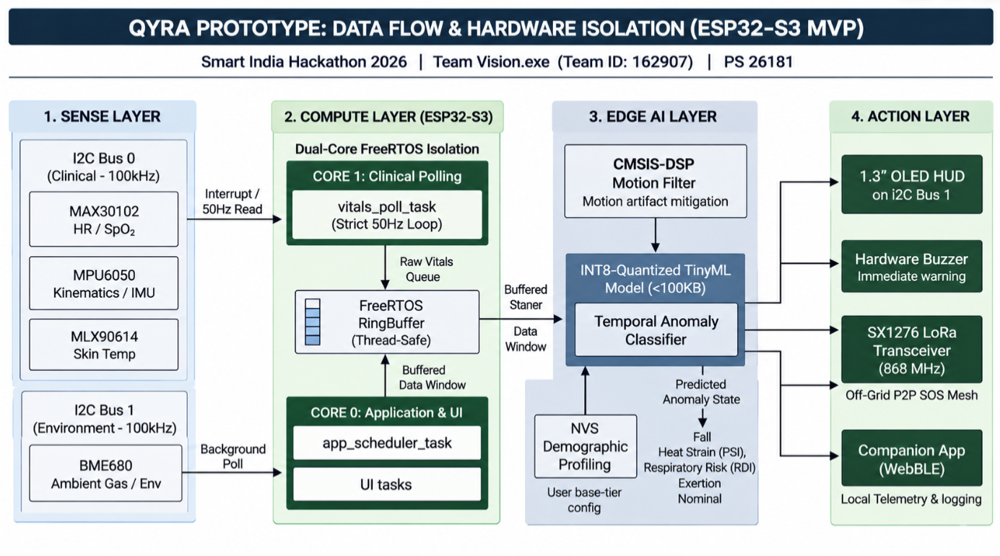

# QYRA Technical Documentation

This directory contains the system design specifications, firmware architecture algorithms, and machine learning documentation for the QYRA edge-computing wearable.

###  Documentation Directory
1. **[RTOS Architecture & Task Isolation](./rtos_architecture.md):** Details our asymmetric FreeRTOS scheduling on the ESP32-S3, explaining how we isolate 50Hz clinical sensor polling from heavy TinyML inference and UI rendering.
2. **[TinyML Triage Matrix & DSP](./tinyml_triage_matrix.md):** Documents our INT8-quantized neural network, the multi-modal physiological risk states (PSI, RDI), demographic-specific NVS profile provisioning, and the CMSIS-DSP motion-artifact filtering pipeline.
3. **[Architecture Flow Diagram](./architecture_flow.png):** Visualizes the end-to-end data pipeline from physical sensor isolation (I2C Bus 0 & Bus 1) to edge TinyML classification and the sub-GHz LoRa SOS mesh.

---

###  Prototype Architecture Data Flow

---

###  Core Engineering Philosophy
The QYRA architecture is built on three strict constraints designed for disaster and heavy-industry deployments:

* **Zero-Cloud Dependency:** The device must provide 100% of its diagnostic value locally without requiring cellular or Wi-Fi infrastructure.
* **Deterministic Timing:** Sensor data must be polled with strict microsecond accuracy, entirely unaffected by Bluetooth interrupts, network retries, or screen draw delays.
* **Data Minimization & Privacy:** Raw biometrics are volatile and heavily protected by DPDP Act principles. The system transmits calculated alert states (e.g., "Heat Strain Critical"), masking raw telemetry to shield Protected Health Information (PHI) by default.
* **Spectrum Isolation:** Employs decentralized peer-to-peer mesh networking utilizing India's de-licensed sub-GHz IN865 band (865–867 MHz) for zero-reliance SOS payloads.

---
*See the [hardware](../hardware) directory for schematic visual assets and Materials details.*
