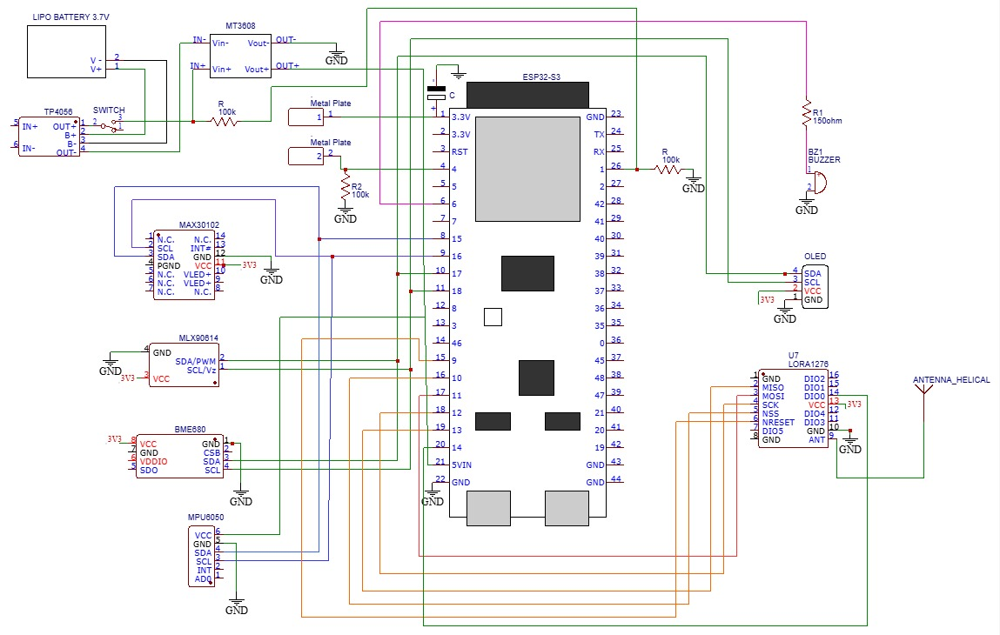
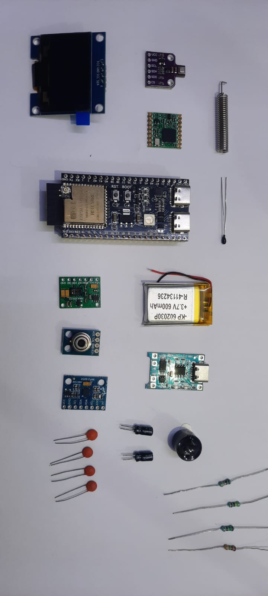

# QYRA Hardware & Physical Architecture of prototype v1

This directory documents the physical design, dual-bus wiring topology, and components the QYRA ESP32-S3 wearable prototype. 

### 📐 Circuit Schematic

### 🔌 Dual I2C Bus Topology
To prevent high-frequency UI refreshes on the OLED screen from blocking the sensitive MAX30102 PPG sensor, the hardware architecture is split across two independent I2C buses on the ESP32-S3:

* **I2C Bus 0 (Clinical - 100kHz):** Dedicated to fast, mission-critical medical sensors.
  * *MAX30102* (Heart Rate & SpO2)
  * *MPU6050* (Kinematics & Fall Detection)
  * *MLX90614* (Non-Contact Infrared Skin Temperature)
* **I2C Bus 1 (Environment & UI - 100kHz):** Dedicated to slower environmental monitoring and HUD rendering.
  * *BME680* (Ambient Temperature, Humidity, and VOC Gas Resistance)
  * *SH1106G* (1.3" OLED Triage Display)

### 🧩 Prototype Assembly & Component Layout
| Component Breakdown | Assembled Prototype (Front & Back) |
| :---: | :---: |
|  |   |

### 📋 Bill of Materials (BOM)
| Component | Function | Interface / Part |
| :--- | :--- | :--- |
| **Microcontroller** | Core processing, FreeRTOS, BLE, & LoRa | ESP32-S3 WROOM-1 DevKit |
| **Vitals Sensor** | Optical heart rate and blood oxygen | SparkFun MAX30102 Module |
| **Skin Temperature** | True non-contact infrared thermal sensor | Adafruit MLX90614 |
| **Kinematics** | 3-axis acceleration and impact tracking | MPU6050 Breakout |
| **Environment** | Ambient gas, humidity, and temperature | BME680 Sensor Module |
| **Display** | 4-quadrant local triage HUD | 1.3" SH1106G OLED |
| **Off-Grid Mesh** | Long-range peer-to-peer disaster radio | SX1276 / RFM95 LoRa (865 MHz) |
| **Power Management** | LiPo charging & safe ADC voltage step-down | TP4056 + Resistor Divider |
